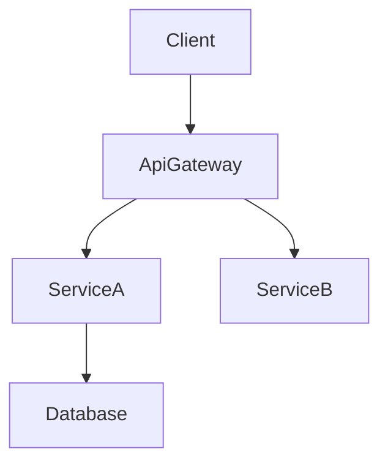

# Technical Design Principles

## Core Principles

### Boundary First
- Settle the boundary before the details: what each component owns, what it depends on, which related responsibilities belong to another spec or an existing module, and which contracts other specs consume
- Do not leak downstream-specific behavior or assumptions into upstream components
- No hidden shared ownership: if two components appear to co-own the same behavior or data, the design is incomplete

### Decide Rather Than Defer
- Make every choice an implementer would otherwise have to guess; "to be decided during tasks or implementation" is not a design
- What genuinely cannot be decided yet goes to Risks and Open Questions, with how it will be resolved

### Contracts, Not Code
- Define components, contracts, and decisions; leave algorithms and code to implementation, except novel algorithms, which may be sketched in pseudo-code
- Specify behavior through inputs, outputs, errors, and pre/postconditions
- What the design does not constrain is the implementer's choice, within steering conventions; constrain only what consistency or correctness requires

### Explicit Contracts
- Every component boundary has explicit types for parameters, return values, and errors, written in the project's language and conventions as recorded in steering
- Keep interfaces minimal and focused, so components can be implemented in parallel without conflicts

### Dependency Direction
- State the allowed dependency direction between layers or components (e.g., Types → Config → Repository → Service → UI); each may depend only on those before it
- Implementation and review treat violations as errors

### Smallest Sufficient Design
- One clear responsibility per component; prefer fewer, cohesive components
- No components, layers, or extension points for hypothetical future requirements

## Choosing the Body

The body between Overview and Components has no fixed structure. Choose its sections for this feature: which sections, their names, order, and depth.

Common contents, each with when it earns a place:

| Content | Include when |
|---------|--------------|
| Context: current state, what the feature builds on and the interfaces it uses from it, related responsibilities owned elsewhere (with their owner), constraints | The feature modifies existing code or depends on other specs or modules |
| Architecture: how components fit together and the allowed dependency direction | The feature has two or more components |
| Decisions: each choice, why, and the main alternative rejected and why | There were real alternatives |
| Interfaces and protocols: signatures, messages, formats, versioning | Components, threads, or processes communicate |
| Data: structures, invariants, persisted formats, compatibility with existing data | Data is added or changed |
| Runtime behavior: flows, state machines, threading and concurrency, startup and shutdown order, timeouts | Behavior unfolds over time or involves concurrency |
| Failure handling: for each failure that matters, how it is detected, reported, and recovered from, and what is logged | The feature does I/O, networking, or anything that can fail at runtime |
| User interface: layout, interaction states, feedback | The feature has a user interface |
| Algorithms | The feature needs a non-obvious algorithm |
| Performance, security, compatibility and migration: concrete targets or rules | Requirements or risks involve them |

- Name sections after the feature's own concepts (e.g., "Session Lifecycle" rather than "Runtime Behavior"), and order them from overview to detail
- Merge, split, or reorder these contents as the feature needs, and add sections for anything else it needs
- Omit what does not apply; a small change may need only one or two sections
- Say each thing once; refer to the section that already states it instead of repeating it
- Mark decisions that hold for the whole project rather than this feature (a new library, a directory or naming convention, a cross-cutting rule) with (project-level)

## Writing Contracts
- **Interfaces**: signature with inputs, outputs, and errors; preconditions and postconditions when they matter
- **Messages** that cross process, thread, or network boundaries: name, direction, fields with types and units, ordering and delivery guarantees, versioning and compatibility, and idempotency when retries happen
- **State machines**: states, transitions with their triggers, and behavior on invalid transitions
- **Data**: structures and invariants; for persisted data, also format, location, and compatibility with existing data

## Failure Handling
- Fail fast on invalid input; degrade gracefully on partial failures
- Cover the failures that matter: invalid input, I/O errors, network loss, timeouts, resource exhaustion, invalid state, partial failure
- State what is logged at the points that matter for diagnosis

## Diagrams
- Add a diagram only where it clarifies, next to the text it explains:
  - **Architecture diagram**: 3+ components or external systems interact
  - **Deployment diagram**: the feature spans processes or machines (which process runs which component, and how they connect)
  - **Class or data relationship diagram**: relationships are non-trivial
  - **Sequence diagram**: 3+ parties exchange messages
  - **Flowchart**: branching logic
  - **State diagram**: lifecycles and state machines
- Do not restate diagram content in prose; use the text for decisions and trade-offs the diagram does not show

### Mermaid requirements

- **Plain Mermaid only** – avoid custom styling or unsupported syntax.
- **Node IDs** – alphanumeric plus underscores only (e.g., `Client`, `ServiceA`). Do not use `@`, `/`, or leading `-`.
- **Labels** – simple words. Do not embed parentheses `()`, square brackets `[]`, quotes `"`, or slashes `/`.
  - ❌ `Lib[@scope/package]` → invalid ID (`@`).
  - ❌ `UI[TaskBoard(UI)]` → invalid label (`()`).
  - ✅ `ScopeLib[scope package]` → use plain text in labels, keep technology details in the accompanying description.
  - ℹ️ Mermaid strict-mode will otherwise fail with errors like `Expecting 'SQE' ... got 'PS'`; remove punctuation from labels before rendering.
- **Edges** – show data or control flow direction.
- **Groups** – using Mermaid subgraphs to cluster related components is allowed; use it sparingly for clarity.

## design.md and research.md
- design.md is self-contained for implementers and reviewers: every decision and contract is stated in it
- research.md holds investigation logs, sources, compared alternatives, and detailed rationale; design.md points to it for background only

## Requirement IDs
- Reference requirements by numeric ID (`2.1, 2.3`), without prefixes such as "Requirement 2.1"
- Use the IDs exactly as defined in requirements.md; if a requirement lacks a numeric ID, stop and fix requirements.md first

## Language and Tone
- Declarative and precise: "The session manager closes idle sessions after 30 s", not "should close idle sessions"
- Essential information only; prefer tables and lists over long prose
